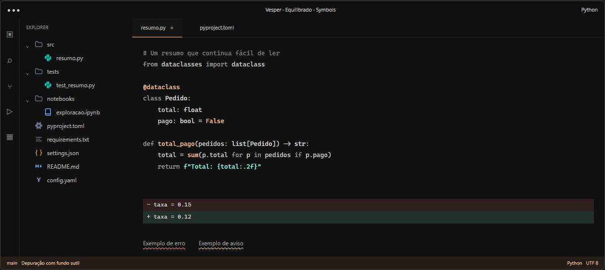

# VS Code com Vesper

Configuração de **Vesper Equilibrado + Symbols com pastas neutras**, preparada para aplicar manualmente no VS Code, inclusive em um ambiente corporativo com restrições à execução de scripts.

O roteiro usa o Marketplace do próprio VS Code e blocos JSONC que podem ser copiados pelo navegador. Git, terminal, PowerShell, Python, npm e instaladores de configuração não são necessários para aplicar a aparência.



*Montagem ilustrativa com a paleta e as formas dos ícones. O resultado de tokens semânticos depende do provedor de linguagem e das configurações do projeto. A imagem não contém código de um projeto pessoal ou corporativo.*

## O que você vai obter

- Fundo quase preto `#101010`, com superfícies integradas.
- Texto neutro `#D0D0D0` e comentários mais legíveis em `#858585`.
- Menta nas strings e pêssego nos destaques, preservando a identidade do Vesper.
- Busca em pêssego, seleção neutra e diffs um pouco mais visíveis.
- Symbols com pastas neutras e arquivos com pistas de cor.
- Minimap e breadcrumbs escondidos; Activity Bar, abas e guias de indentação disponíveis.
- Fonte Cascadia Code NF, quando instalada, com fallback para Consolas no Windows.

## Comece por aqui

1. **Guarde uma cópia das suas configurações atuais.** Abra a paleta com `Ctrl+Shift+P`, procure por **Open User Settings (JSON)** / **Configurações do Usuário (JSON)** e copie o conteúdo para um arquivo de backup local.
2. **Instale Vesper e Symbols pelo VS Code.** No painel de extensões, pesquise pelos IDs exatos da tabela abaixo e clique em **Install / Instalar**. Confirme o publicador.
3. **Mescle o preset visual** de [settings/vesper.jsonc](settings/vesper.jsonc) nas configurações do usuário ou do perfil. O mesmo conteúdo está no bloco expansível abaixo; você pode copiá-lo sem baixar o repositório.
4. **Se usa Python com coloração semântica**, acrescente [settings/python.jsonc](settings/python.jsonc), unindo o bloco `[python]` ao que já existir. A instalação de ferramentas Python é independente da aparência.
5. **Confira a fonte.** Se Cascadia Code NF não estiver instalada, a configuração usa Consolas no Windows. Você já pode usar o tema sem instalar fonte nova. Veja [o guia de fontes](docs/fontes.md) se quiser reproduzir também a tipografia.
6. **Confira o resultado** com [examples/amostra.py](examples/amostra.py). Basta abrir o arquivo; não é preciso executá-lo. Se os ícones não atualizarem, use **Developer: Reload Window**, salvando antes o trabalho em andamento.

**Mescle as propriedades.** Se seu `settings.json` já tem conteúdo, não substitua o arquivo inteiro e não acrescente outro objeto `{ ... }` depois do que já existe. A [explicação com exemplos](docs/aplicar-configuracoes.md) mostra como preservar as outras preferências e evitar chaves duplicadas.

## Extensões necessárias para a aparência

| Componente | ID exato | Publicador | Versão validada |
| --- | --- | --- | --- |
| [Vesper](https://marketplace.visualstudio.com/items?itemName=raunofreiberg.vesper) | `raunofreiberg.vesper` | Rauno Freiberg | `0.0.40` |
| [Symbols](https://marketplace.visualstudio.com/items?itemName=miguelsolorio.symbols) | `miguelsolorio.symbols` | Miguel Solorio | `0.0.26` |

As versões são a referência testada em **07/11/2026**, não uma exigência de instalar versões antigas. As extensões serão obtidas pelo Marketplace; o repositório não distribui seus pacotes.

Python, Pylance e Python Debugger **não são necessários para instalar o tema e os ícones**. Se já fazem parte do seu ambiente de trabalho, mantenha a instalação e as convenções que você usa. [Detalhes para Python e WSL](docs/instalacao-corporativa.md#python-e-wsl).

## Copiar as configurações direto desta página

Use os blocos a seguir caso você consiga ler o GitHub, mas prefira não baixar arquivos. JSONC é JSON com comentários, aceito pelo editor de configurações do VS Code. [Documentação oficial](https://code.visualstudio.com/docs/configure/settings).

<details>
<summary><strong>1 Preset visual principal</strong></summary>

Copie este objeto inteiro somente se suas configurações estiverem vazias. Se já houver conteúdo, mescle suas propriedades ao objeto existente.

```jsonc
// Preset visual principal: Vesper Equilibrado + Symbols com pastas neutras.
// Mescle nas configuracoes de usuario ou do perfil. Preserve suas outras chaves.
// Cascadia Code NF e opcional: Consolas funciona como fallback no Windows.
{
  "workbench.colorTheme": "Vesper",
  "window.autoDetectColorScheme": false,
  "workbench.iconTheme": "symbols",
  "editor.fontFamily": "'Cascadia Code NF', Consolas, monospace",
  "editor.fontLigatures": true,
  "editor.fontSize": 14,
  "editor.lineHeight": 22,
  "editor.fontWeight": "400",
  "editor.letterSpacing": 0,
  "editor.minimap.enabled": false,
  "breadcrumbs.enabled": false,
  "editor.renderWhitespace": "selection",
  "editor.guides.indentation": true,
  "editor.guides.highlightActiveIndentation": true,
  "workbench.activityBar.location": "default",
  "editor.stickyScroll.enabled": true,
  "workbench.editor.showTabs": "multiple",
  "workbench.colorCustomizations": {
    "[Vesper]": {
      "editor.background": "#101010",
      "sideBar.background": "#101010",
      "sideBarSectionHeader.background": "#101010",
      "activityBar.background": "#101010",
      "editorGroupHeader.tabsBackground": "#101010",
      "tab.inactiveBackground": "#101010",
      "titleBar.activeBackground": "#101010",
      "titleBar.inactiveBackground": "#101010",
      "statusBar.background": "#101010",
      "statusBar.noFolderBackground": "#101010",
      "tab.border": "#00000000",
      "sideBar.border": "#00000000",
      "editorGroup.border": "#00000000",
      "titleBar.border": "#00000000",
      "statusBar.border": "#00000000",
      "editor.findMatchBackground": "#FFC79926",
      "editor.findMatchBorder": "#FFC79980",
      "editor.findMatchHighlightBackground": "#FFC79914",
      "editor.selectionBackground": "#FFFFFF25",
      "editor.selectionHighlightBackground": "#FFFFFF14",
      "editor.wordHighlightBackground": "#FFFFFF0F",
      "editor.wordHighlightStrongBackground": "#FFC79918",
      "statusBar.debuggingBackground": "#241C17",
      "statusBar.debuggingForeground": "#FFC799",
      "statusBarItem.remoteBackground": "#1C1C1C",
      "statusBarItem.remoteForeground": "#FFC799",
      "editor.foreground": "#D0D0D0",
      "editorLineNumber.foreground": "#707070",
      "editorLineNumber.activeForeground": "#B0B0B0",
      "tab.activeBackground": "#161616",
      "input.background": "#1C1C1C",
      "editorWidget.background": "#101010",
      "editorHoverWidget.background": "#161616",
      "editorHoverWidget.border": "#282828",
      "editorGroupHeader.tabsBorder": "#00000000",
      "diffEditor.insertedLineBackground": "#99FFE422",
      "diffEditor.insertedTextBackground": "#99FFE422",
      "diffEditor.removedLineBackground": "#FF808022",
      "diffEditor.removedTextBackground": "#FF808022"
    }
  },
  "symbols.hidesExplorerArrows": false,
  "symbols.folders.associations": {
    "src": "folder",
    "tests": "folder",
    "data": "folder",
    "notebooks": "folder",
    ".venv": "folder"
  },
  "editor.tokenColorCustomizations": {
    "[Vesper]": {
      "comments": "#858585",
      "textMateRules": [
        {
          "name": "Vesper variáveis no tom escolhido",
          "scope": [
            "variable",
            "meta.block variable.other",
            "support.other.variable",
            "string constant.other.placeholder"
          ],
          "settings": {
            "foreground": "#D0D0D0"
          }
        },
        {
          "name": "Vesper delimitadores de comentário legíveis",
          "scope": "punctuation.definition.comment",
          "settings": {
            "foreground": "#858585"
          }
        }
      ]
    }
  }
}
```

</details>

<details>
<summary><strong>2 Python com semântica opcional</strong></summary>

Mescle `[python]` ao bloco existente. Preserve suas opções de formatação, testes e análise. As regras abaixo usam os tokens de Python fornecidos por um servidor de linguagem, como Pylance.

```jsonc
// Opcional: coloracao semantica de Python usando a paleta do Vesper.
// Mescle [python] ao bloco existente, preservando formatacao, testes e analise.
// Requer um provedor de tokens semanticos, como Pylance, para essa camada ter efeito.
{
  "[python]": {
    "editor.semanticHighlighting.enabled": true
  },
  "editor.semanticTokenColorCustomizations": {
    "[Vesper]": {
      "rules": {
        "variable:python": "#D0D0D0",
        "parameter:python": "#D0D0D0",
        "property:python": "#D0D0D0",
        "variable.readonly:python": "#FFC799",
        "function:python": "#FFC799",
        "method:python": "#FFC799",
        "decorator:python": "#FFC799",
        "class:python": "#E0E0E0",
        "type:python": "#E0E0E0"
      }
    }
  }
}
```

</details>

<details>
<summary><strong>3 Fonte alternativa no Windows</strong></summary>

Aplique se quiser fixar Consolas. Sem esse bloco, o preset já tenta Consolas quando Cascadia Code NF não está disponível. Consolas não oferece as ligaduras de programação do Cascadia Code.

```jsonc
// Opcional para Windows: fixa Consolas quando voce prefere a fonte ja disponivel.
// Consolas nao fornece ligaduras de programacao.
// Para outra fonte corporativa, altere editor.fontFamily para o nome instalado.
{
  "editor.fontFamily": "Consolas, monospace",
  "editor.fontLigatures": false
}
```

</details>

<details>
<summary><strong>4 Fonte do terminal integrado opcional</strong></summary>

Use somente se quiser reproduzir a fonte do terminal do ambiente de referência. Mantenha sua configuração atual quando ela já atende ao seu prompt e aos seus glifos.

```jsonc
// Opcional: reproduz a fonte do terminal integrado do ambiente de referencia.
// Mantenha sua fonte atual se o terminal corporativo ja usa glifos ou um prompt proprio.
{
  "terminal.integrated.fontFamily": "'Cascadia Code NF', Consolas, monospace"
}
```

</details>

## Qual arquivo usar

| Arquivo | Quando usar |
| --- | --- |
| [vesper.jsonc](settings/vesper.jsonc) | Caminho principal: cores, ícones, fonte do editor e layout |
| [python.jsonc](settings/python.jsonc) | Acrescentar a coloração semântica de Python |
| [fontes-alternativas.jsonc](settings/fontes-alternativas.jsonc) | Fixar uma alternativa de fonte no Windows |
| [terminal.jsonc](settings/terminal.jsonc) | Reproduzir também a fonte do terminal integrado |
| [replica-completa.jsonc](settings/replica-completa.jsonc) | Consultar ou reproduzir de uma vez o preset completo validado, incluindo Python e terminal |

Escolha o roteiro em partes **ou** a réplica completa. Você não precisa aplicar ambos. Os arquivos são referências de configuração; o VS Code não lê nem aplica este repositório automaticamente.

## Guia detalhado

- [Instalação manual no ambiente corporativo](docs/instalacao-corporativa.md)
- [Como mesclar os JSON sem perder configurações](docs/aplicar-configuracoes.md)
- [Fontes e alternativas disponíveis](docs/fontes.md)
- [O que cada ajuste faz](docs/configuracoes.md)
- [Restrições e diagnóstico de problemas](docs/restricoes-e-alternativas.md)
- [Validação e reversão](docs/validar-e-reverter.md)

Você pode criar um perfil **Vesper Trabalho** copiando o perfil corporativo atual antes de aplicar o JSON. Isso facilita voltar ao perfil anterior. O uso de perfis é opcional e a importação automática de extensões não faz parte do roteiro principal. [Perfis no VS Code](https://code.visualstudio.com/docs/configure/profiles).

## Referência e manutenção

Configuração validada no VS Code Desktop **1.141.0 para Windows**, também com uma janela WSL. A versão publicada do Symbols exige VS Code `^1.88.0`; o Vesper exige `^1.75.0`. Isso não é garantia de compatibilidade de cada ajuste com todas as versões entre esses limites. Veja a versão disponível na sua empresa e [o diagnóstico](docs/restricoes-e-alternativas.md) se aparecer uma configuração desconhecida.

[componentes.json](componentes.json) registra IDs, versões, origem e ambiente validado. [CHANGELOG.md](CHANGELOG.md) registra mudanças do preset. Não há dependência de comandos de instalação, sincronização de conta pessoal ou ferramentas de geração para usar estes arquivos.

## Créditos

[Vesper](https://github.com/raunofreiberg/vesper), por Rauno Freiberg; [Symbols](https://github.com/miguelsolorio/vscode-symbols), por Miguel Solorio; [Cascadia Code](https://github.com/microsoft/cascadia-code), pela Microsoft. Este repositório contém uma curadoria de configurações e documentação. Veja [LICENSE](LICENSE) e [THIRD_PARTY_NOTICES.md](THIRD_PARTY_NOTICES.md).
